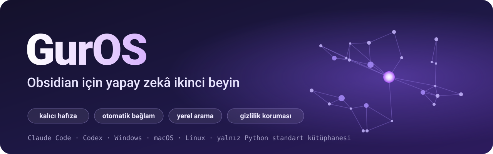
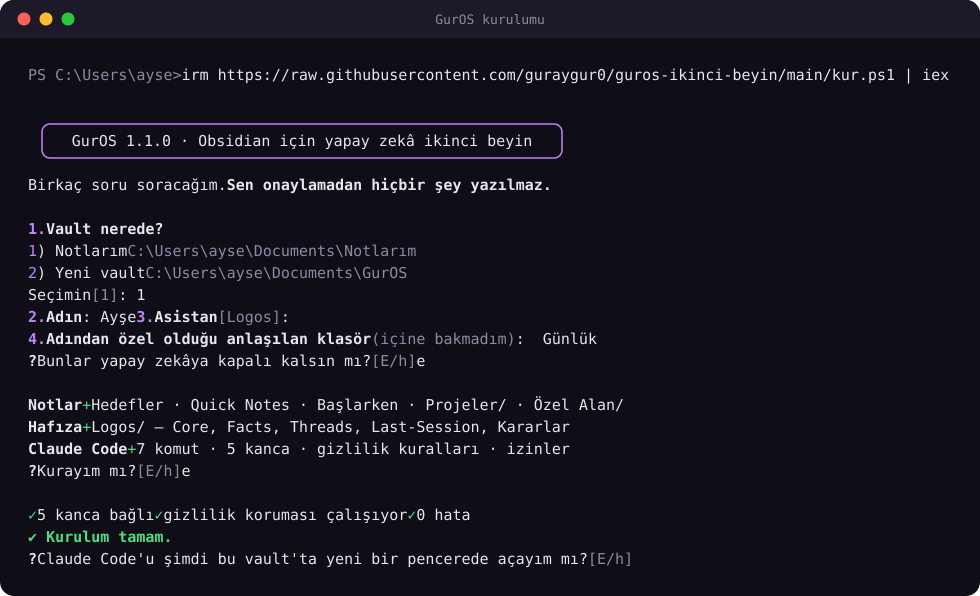
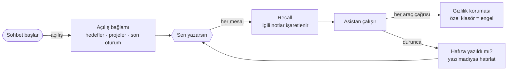

<p align="center">
  
</p>

<p align="center">
  <a href="https://github.com/guraygur0/guros-ikinci-beyin/actions/workflows/test.yml"></a>
  
  
  <a href="LICENSE"></a>
</p>

Obsidian vault'unu seni hatırlayan bir yapay zekâ ortağına dönüştürür. Asistan her sohbete hedeflerini,
projelerini ve geçen sefer kaldığın yeri bilerek başlar. Öğrendiklerini kendi hafıza klasörüne yazar ve
senin özel klasörüne giremez.

## ⚡ Kurulum: tek satır

**Windows** — Başlat menüsünde "PowerShell" aç, yapıştır, Enter:

```powershell
irm https://raw.githubusercontent.com/guraygur0/guros-ikinci-beyin/main/kur.ps1 | iex
```

**macOS / Linux** — Terminal'i aç, yapıştır, Enter:

```bash
curl -fsSL https://raw.githubusercontent.com/guraygur0/guros-ikinci-beyin/main/kur.sh | bash
```

Kurulum dört soru sorar, ne yapacağını gösterir ve **sen onaylamadan hiçbir şey yazmaz**:

- Obsidian vault'larını kendisi bulur.
- Python yoksa kurmayı teklif eder.
- Günlük gibi özel görünen klasörleri yalnızca adlarına bakarak bulur ve kapatmayı önerir; içlerini açmaz.

İnternetten bir komut çalıştırmadan önce içine bakmak istersen: [kur.ps1](kur.ps1) · [kur.sh](kur.sh).

<p align="center"></p>

## 🤖 Ya da yapay zekâna kurdur

Komut çalıştırabilen bir yapay zekâ aracına (Claude Code, Codex, Cursor'un ajan modu) şunu yaz:

```
https://github.com/guraygur0/guros-ikinci-beyin
bu sistemi bana kur
```

Asistan şu adımları izler:

1. Sana vault'unu, adını ve hangi klasörlerin kapalı kalacağını sorar.
2. Planı gösterir.
3. Onaylarsan kurar ve sağlık kontrolünü çalıştırır.

Asistanların izlediği adımlar [KURULUM-AI.md](KURULUM-AI.md) dosyasında.

## Kurduktan sonra ne görürsün

1. **Obsidian'da** vault'u açınca birkaç yeni not görürsün:
   - Hedeflerin,
   - hızlı notların,
   - projelerin,
   - asistanın hafıza klasörü,
   - nasıl kullanılacağını anlatan bir `👋 Başlarken` notu.
2. **Claude Code'u vault klasöründe başlatırsın** (`claude`). İlk açılışta *"Do you trust the files in this
   folder?"* diye sorar. **Yes** de. Bu ekran GurOS'un kancalarını ve izinlerini listeler; hafıza ve gizlilik
   koruması ancak bu onaydan sonra çalışır.
3. **"merhaba" yazarsın.** Hafıza boşken asistan seni tanımaya çalışır:

   > Merhaba! Ben **Logos** — senin ikinci beynin ve düşünce ortağın olacağım bu vault üzerinden. Hafızam şu an
   > tamamen boş, yani seni henüz tanımıyorum. Sen kimsin, ne ile uğraşıyorsun? Yakın vadede ulaşmak istediğin
   > hedefler var mı? Anlattıklarını senin onayınla `Core.md` ve `Facts.md`'ye kaydedip buradan devam edeceğim.

4. **Günler sonra "nerede kalmıştık?"** dediğinde asistan kaldığın yerden devam eder:

   > **Proje: Alışkanlık Uygulaması** — Veritabanı olarak SQLite seçildi · Ana ekran tasarımı bitti ·
   > **Sıradaki adım:** Giriş ekranını bitir. Açık hedeflerin de duruyor: İspanyolca A2 sınavı ve haftada 3 gün koşu.
   > Giriş ekranına mı devam edelim?

5. **Özel klasörünü** istesen de açamaz:

   > Bu klasöre erişemem — özel alan olarak işaretli, okuma/arama/özetleme yapmam yasak. İstersen ilgili kısmı
   > sen yapıştır, ondan konuşabiliriz.

*(Alıntılar, deneme vault'unda Claude Code ile yapılan gerçek denemelerden.)*

## Ne kazanırsın

| | |
|---|---|
| 🧠 **Kalıcı hafıza** | Kim olduğun, kararların, süren işlerin ve oturum özetleri vault'unda düz Markdown olarak durur. Obsidian'da okuyup düzeltebilirsin. |
| 🌅 **Otomatik bağlam** | Her sohbetin başında açık hedefler, projelerin sıradaki adımı ve son oturum asistana kendiliğinden verilir. |
| 🔎 **Yerel arama (Recall)** | Her mesajda ilgili notlar bulunur ve asistana gösterilir. Türkçe ekleri ve Türkçe–İngilizce eş anlamlıları tanır: "uzay filmi" araması `Filmler/Interstellar` notunu bulur. Model ya da internet kullanmaz. |
| 🔒 **Gizlilik koruması** | Özel klasörlerine okuma, arama ya da kabuk komutuyla girilemez. Klasörün adı geçmeden yapılan geniş aramalar da engellenir. |
| ⏰ **Unutmaz** | Uzun bir sohbette hafızaya bir süre bir şey yazılmazsa asistan durdurulur ve yazması istenir. |
| 🙅 **Notlarına saygılı** | Kurulum hiçbir notu ezmez; tekrar çalıştırılabilir. Asistanın kuralları var olan notlarını sormadan değiştirmeyi yasaklar. |
| 🪶 **Hafif** | Yalnızca Python standart kütüphanesi kullanılır. Windows, macOS ve Linux'ta çalışır. Obsidian eklentisi gerekmez. |

**Claude Code** ile her parça çalışır. **Codex** ve diğer ajanlar aynı kuralları `AGENTS.md` dosyasından
okur; ancak otomatik kancalar bu araçlarda çalışmaz.

## Nasıl çalışır



Hafıza dört türdür, her birinin yeri bellidir:

- **Çalışma:** açılış bağlamı.
- **Epizodik:** biten işler ve sohbet devirleri.
- **Anlamsal:** seninle ilgili bilgiler ve kararlar.
- **Prosedürel:** komutlar ve projelerde öğrenilenler.

Ayrıntılar [docs/NASIL-CALISIR.md](docs/NASIL-CALISIR.md) dosyasında.

<details>
<summary><b>Neler kurulur</b> (dosya ağacı)</summary>

```
Vault/
├── 👋 Başlarken.md          nasıl kullanılır (okuyunca silebilirsin)
├── 🎯 Hedefler.md           "- [ ] hedef" satırları; açık olanlar her sohbetin başında görünür
├── ⚡ Quick Notes.md        hızlı yakalama
├── Projeler/               her proje için bir not: ne, sıradaki adım, öğrenilenler
├── 🔒 Özel Alan/            yapay zekâya kapalı
├── 🔮 Logos/                asistanın hafızası: Core, Facts, Threads, Last-Session, Kararlar, Journal,
│                           Epizotlar, Session-Handoffs/
├── CLAUDE.md               asistanın kuralları (Claude Code her sohbette okur)
├── AGENTS.md               aynı kurallar Codex ve diğer ajanlar için
└── .claude/
    ├── settings.json       kancalar ve izin kuralları (var olan ayarların korunur, önce yedeklenir)
    ├── commands/           /recall /baglam /doktor /devir /epizot /proje /hafiza
    └── guros/              sistem kodu
```

Bu yapı kendi klasörlerinin **yanına** eklenir; senin düzenine dokunulmaz.
</details>

## Gizlilik

- **Özel klasörler iki katla korunur.**
  - Birinci kat GurOS'un koruma kancasıdır. Klasörün adını geçiren her okuma, düzenleme ve kabuk
    komutunu engeller. Ad vermeden onu da süpüren aramaları da engeller: vault kökünden `grep -r`, `find .`,
    `**/*.md` gibi.
  - İkinci kat Claude Code'un kendi izin kurallarıdır.
- **Recall özel klasörleri hiç indekslemez.** Devir ve epizot kayıtları bu klasörlerin adını içeren
  metni yazmayı reddeder. İsteğe bağlı yedeğe de girmezler.
- **Koruma bir emniyet kemeridir, kasa değil.** Kurallara uyan bir asistanın kazara içeri girmesini önler.
  Dosyaları kendisi açan bir betik gibi dolaylı yolların hepsini yakalayamaz. İşletim sistemi düzeyinde engel
  için Claude Code'un [sandbox](https://code.claude.com/docs/en/sandboxing) özelliğini aç. Gerçekten hassas
  bilgiyi vault dışında ya da şifreli tut.
- **Arama yereldir, sohbet değildir.** Recall ve hafıza betikleri bilgisayarından dışarı bir şey göndermez.
  Asistanın sohbette okuduğu notlar ise yapay zekâ sağlayıcısına (Anthropic, OpenAI…) gider. Göstermek
  istemediğini özel klasörde tut.
- **İzinler dar tutulur.** Asistan yalnız kendi hafıza klasörüne ve GurOS'un altı betiğine her seferinde
  izin sormadan erişir. Yedek gibi dışarı veri gönderen işler yine onay ister.

## Günlük kullanım

Asistanla normal konuş; gerisini kurallar halleder. İstersen komutlar:

| Komut | Ne yapar |
|---|---|
| `/recall bütçe` | Vault'ta ara |
| `/baglam` | Açılış bağlamını yeniden göster |
| `/proje` | Proje notu aç, sıradaki adımı ya da öğrenilen bir dersi ekle |
| `/devir` | Bu sohbeti kaydet, sonraki sohbet buradan devam etsin |
| `/epizot` | Biten bir işi kaydet |
| `/hafiza` | Hafızayı gözden geçir |
| `/doktor` | Sağlık kontrolü |

İpuçları:

- Hedeflerini `🎯 Hedefler.md` dosyasına `- [ ] ...` biçiminde yaz.
- Yeni bir işe başlarken asistandan proje notu açmasını iste.
- Telefonla eşitleme yapıyorsan da sorun olmaz: asistan notları baştan yazmak yerine sonlarına ekler.

## Güncelleme ve kaldırma

Kurulum komutunu **yeniden çalıştır**. Sihirbaz GurOS'un kurulu olduğunu görür ve sorar:

- **Güncelle:** sistem ve kurallar yenilenir; notların ve hafızan aynen kalır.
- **Kaldır:** kancalar, komutlar, sistem kodu ve GurOS kuralları çıkar; notların ve hafızan yerinde kalır.

İsteğe bağlı yedek ve günlük bakım için [docs/BAKIM.md](docs/BAKIM.md).

<details>
<summary><b>Elle kurulum</b> (git ile ya da ZIP'ten)</summary>

Gerekenler:
- [Python 3.9+](https://www.python.org/downloads/). Windows'ta "Add python.exe to PATH" kutusunu işaretle.
- [Obsidian](https://obsidian.md).
- [Claude Code](https://code.claude.com/docs/en/setup) ya da Codex.

```bash
git clone https://github.com/guraygur0/guros-ikinci-beyin.git
cd guros-ikinci-beyin
python kur.py          # macOS/Linux: python3 kur.py — sihirbaz açılır
```

git yoksa sayfanın üstündeki **Code → Download ZIP** ile indirip aç. Kodu vault'unun **dışına** koy.

Soru sormadan, bayraklarla kurulum (önce plan, sonra `--uygula`):

```bash
python kur.py --vaultlar                                                # bilgisayardaki vault'lar
python kur.py --vault "C:\Users\sen\Documents\Vault" --ad "Ayşe"         # yalnızca plan
python kur.py --vault "C:\Users\sen\Documents\Vault" --ad "Ayşe" --uygula
```

| Seçenek | Varsayılan | Ne işe yarar |
|---|---|---|
| `--ad` | Kullanıcı | Asistanın sana hitap ettiği ad |
| `--asistan` | Logos | Asistanın adı |
| `--ozel "Günlük"` | `🔒 Özel Alan` | Yapay zekâya kapalı klasör; birden çok kez verilebilir |
| `--hafiza` | `🔮 Logos` | Asistanın hafıza klasörü |
| `--proje` | `Projeler` | Proje notlarının klasörü |
| `--zamanla --saat 10:00` | kapalı | Günlük bakım: arama indeksi, sağlık kontrolü, varsa yedek |
| `--kaldir` | | Kaldırma planı (`--uygula` ile kaldırır) |
</details>

## Sık sorulanlar

<details><summary><b>Var olan vault'uma kurarsam notlarım bozulur mu?</b></summary>

Hayır. Kurulum yalnızca eksik dosyaları ekler.

- `CLAUDE.md` zaten varsa metnine dokunulmaz. Kurallar `CLAUDE.guros.md` dosyasına yazılır, senin dosyanın sonuna
  tek bir `@CLAUDE.guros.md` satırı eklenir.
- `.claude/settings.json` değişmeden önce yedeklenir.
- Plan gösterilmeden hiçbir şey yazılmaz.
</details>

<details><summary><b>Ücretli mi?</b></summary>

GurOS ücretsiz ve açık kaynaktır. Claude Code ücretli bir Claude hesabı ister (Pro, Max, Team, Enterprise ya da
Console); ücretsiz plan Claude Code'u kapsamaz. Codex kendi koşullarıyla çalışır.
</details>

<details><summary><b>Claude Code yüklü değil, ne yapmalıyım?</b></summary>

Kurulum sonunda sana resmi kurulum komutunu gösterir:

- Windows PowerShell: `irm https://claude.ai/install.ps1 | iex`
- macOS / Linux: `curl -fsSL https://claude.ai/install.sh | bash`

Ayrıntılar [Claude Code belgelerinde](https://code.claude.com/docs/en/setup).
</details>

<details><summary><b>Windows'ta Git yüklü değil, sorun olur mu?</b></summary>

Hayır. GurOS'un kancaları kabuk kullanmadan doğrudan çalışır. Git yalnızca isteğe bağlı yedek için gerekir.
</details>

<details><summary><b>İnternet gerekiyor mu?</b></summary>

Arama ve hafıza betikleri için gerekmez. Yapay zekâ asistanının kendisi için gerekir.
</details>

<details><summary><b>Asistanın adını sonradan değiştirebilir miyim?</b></summary>

Evet:

- `--asistan "Ada"` ile yeniden kur, ya da
- `.claude/guros/ayarlar.json` dosyasını düzenleyip kurulumu yeniden çalıştır.
</details>

<details><summary><b>Testler?</b></summary>

`python tests/run_tests.py`. Testler geçici bir vault kurar; gerçek vault'una dokunmaz. Her değişiklikte
Windows, macOS ve Linux'ta otomatik çalışırlar.
</details>

## Bu pakette olmayanlar

Videoda görünen bazı parçalar kişisel kurulumuma özel ve bu pakete alınmadı: kişisel otomasyonlarım ve tabii ki
notlarım. Bu paket, herkesin kendi vault'unda kullanabileceği çekirdektir: hafıza, bağlam, arama, gizlilik ve bakım.

## Lisans

[MIT](LICENSE). İstediğin gibi kullan, değiştir, paylaş.

---

<sub>**English:** GurOS adds persistent memory, automatic session context, local Turkish/English keyword search and a
privacy guard to an Obsidian vault — fully for Claude Code, and through `AGENTS.md` for Codex and other agents.
Install with one line (`irm …/kur.ps1 | iex` on Windows, `curl -fsSL …/kur.sh | bash` on macOS/Linux), or give this
URL to an AI coding agent and say "install this for me". Standard-library Python only. Prompts and notes are in Turkish.</sub>
